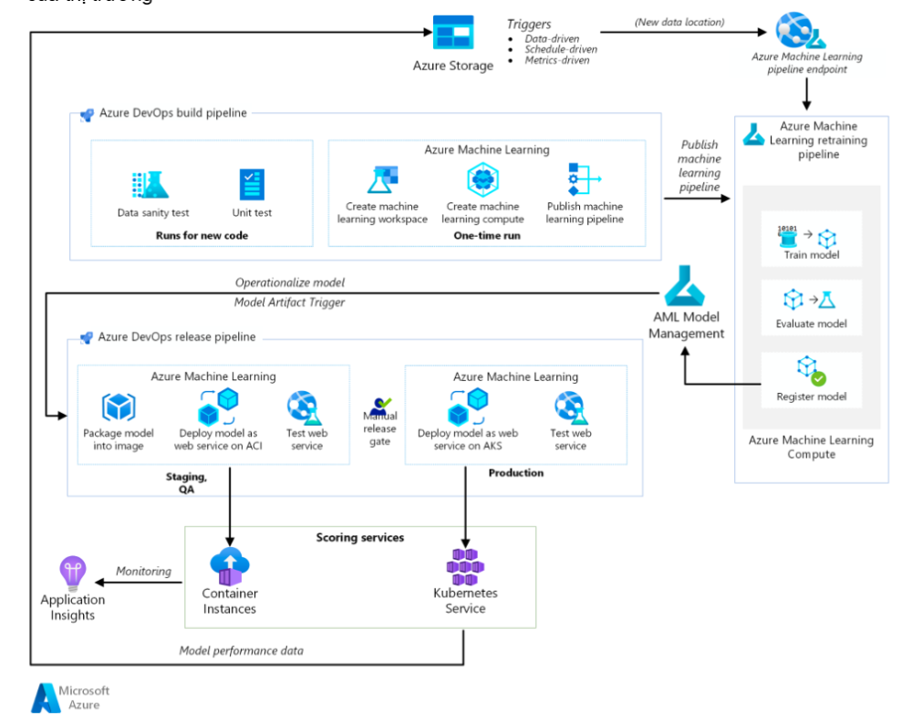

# Azure Retail Demand Forecasting MLOps

An academic project focused on implementing an end-to-end **Machine Learning Operations (MLOps)** workflow on **Microsoft Azure** for retail demand forecasting using Python.

The project aims to automate the machine learning lifecycle, including data preparation, model training, evaluation, containerization, and cloud deployment through CI/CD pipelines.

## Project Overview

Retail demand forecasting uses historical sales data to predict future product demand across stores and items.

This project demonstrates how MLOps practices can be applied to automate model development and deployment. The system is designed to support automated builds, testing, retraining, and model deployment when training data or source code changes.

### Objectives

- Prepare and manage historical retail sales data.
- Develop and evaluate machine learning forecasting models.
- Store training datasets and model artifacts in Azure Blob Storage.
- Train and manage machine learning models using Azure Machine Learning.
- Implement CI/CD workflows using Azure Pipelines.
- Containerize the prediction service using Docker.
- Manage container images using Azure Container Registry.
- Deploy the prediction service using Azure Container Instances.
- Explore scalable model deployment using Azure Kubernetes Service.

## Technology Stack

| Category | Technologies |
|---|---|
| Programming Language | Python |
| Data Processing | Pandas, NumPy |
| Machine Learning | Scikit-learn, XGBoost |
| Backend API | FastAPI |
| Frontend | React |
| Cloud Platform | Microsoft Azure |
| Data Storage | Azure Blob Storage |
| Machine Learning Platform | Azure Machine Learning |
| CI/CD | Azure Pipelines |
| Containerization | Docker |
| Container Registry | Azure Container Registry (ACR) |
| Cloud Deployment | Azure Container Instances (ACI) |
| Scalable Deployment | Azure Kubernetes Service (AKS) |
| Version Control | Git, GitHub |

## MLOps Workflow

The proposed MLOps workflow includes the following stages:

1. **Data Collection:** Collect historical retail sales data.
2. **Data Preparation:** Clean, transform, and store training datasets in Azure Blob Storage.
3. **Model Training:** Train forecasting models using Python and Azure Machine Learning.
4. **Model Evaluation:** Evaluate model performance using appropriate regression metrics.
5. **Model Registration:** Manage trained models and their versions in Azure Machine Learning.
6. **Continuous Integration:** Validate source code, dependencies, and tests using Azure Pipelines.
7. **Continuous Deployment:** Build Docker images and publish them to Azure Container Registry.
8. **Cloud Deployment:** Deploy the prediction API using Azure Container Instances or Azure Kubernetes Service.
9. **Monitoring and Retraining:** Monitor model performance and support retraining when data or code changes.

### Reference MLOps Architecture

The following diagram illustrates the Microsoft Azure MLOps reference architecture, including automated training pipelines, CI/CD, model deployment, and monitoring.



*Figure 1. Microsoft Azure MLOps reference architecture.*

### Proposed Project Architecture

```text
                 Retail Sales Dataset
                          |
                          v
                  Data Preprocessing
                          |
                          v
                  Azure Blob Storage
                          |
                          v
                Azure Machine Learning
                          |
              +-----------+-----------+
              |           |           |
              v           v           v
         Training     Evaluation   Registration
              |           |           |
              +-----------+-----------+
                          |
                          v
                   Trained Model
                          |
                          v
                    Azure Pipelines
                          |
                          v
                    Docker Image
                          |
                          v
                Azure Container Registry
                          |
                +---------+---------+
                |                   |
                v                   v
        Azure Container       Azure Kubernetes
        Instances (ACI)        Service (AKS)
                |                   |
                +---------+---------+
                          |
                          v
                     FastAPI API
                          |
                          v
                   React Frontend
                          |
                          v
                  Demand Forecasts
```

## Project Structure

```text
.
├── README.md
├── picture/
│   └── azure.png                # Azure MLOps architecture diagram
│
├── data/
│   ├── raw/                     # Original datasets
│   ├── processed/               # Cleaned and transformed datasets
│   └── external/                # External or supplementary datasets
│
├── notebooks/                   # Exploratory analysis and ML experiments
│
├── src/
│   ├── data/                    # Data ingestion and preprocessing
│   ├── features/                # Feature engineering
│   ├── models/                  # Model training, evaluation and prediction
│   └── pipelines/               # Machine learning workflows
│
├── backend/
│   └── app/
│       ├── api/                 # REST API endpoints
│       ├── schemas/             # Request and response schemas
│       └── services/            # Prediction and business logic
│
├── frontend/                    # Web interface
│
├── deployment/
│   ├── docker/                  # Docker configurations
│   └── azure/
│       ├── aci/                 # Azure Container Instances deployment
│       └── aks/                 # Azure Kubernetes Service deployment
│
├── tests/                       # Automated tests
├── scripts/                     # Utility and automation scripts
├── artifacts/                   # Model artifacts and evaluation outputs
│
└── reports/
    ├── figures/                 # Charts and visualizations
    └── final_report/            # Project documentation
```

## Dataset

The project uses historical retail sales data for demand forecasting.

**Dataset:** [M5 Forecasting – Accuracy - Kaggle](https://www.kaggle.com/competitions/m5-forecasting-accuracy/data). The raw CSV files are stored locally in `data/raw/` and excluded from Git. See `reports/Hung/data_profile.md` for the H01 data profile and proposed MVP item list.

The dataset contains daily sales records with the following attributes:

| Column | Description |
|---|---|
| `item_id` | Product identifier |
| `store_id` | Store identifier |
| `d_1`…`d_1941` | Daily unit sales in the evaluation file |
| `calendar.csv` | Mapping from day key to calendar date and events |
| `sell_prices.csv` | Weekly prices by store and item |

The primary forecasting objective is to predict future product sales using historical demand patterns.

## Azure Services

### Azure Pipelines

Automates build, test, and deployment workflows for the machine learning application.

### Azure Machine Learning

Provides infrastructure for model training, experiment tracking, model management, and machine learning workflows.

### Azure Blob Storage

Stores training datasets, processed data, and trained model artifacts.

### Azure Container Registry

Stores and manages Docker container images used for deployment.

### Azure Container Instances

Runs the containerized prediction service in the cloud.

### Azure Kubernetes Service

Supports container orchestration and scalable deployment of machine learning services.

## References

- [Microsoft Azure MLOps Reference Architecture](https://learn.microsoft.com/en-us/azure/architecture/reference-architectures/ai/mlops-python)
- [Microsoft MLOpsPython Repository](https://github.com/Microsoft/MLOpsPython)
- [Introduction to MLOps - Microsoft Learn](https://learn.microsoft.com/en-us/training/modules/start-ml-lifecycle-mlops/)
- [M5 Forecasting – Accuracy Dataset](https://www.kaggle.com/competitions/m5-forecasting-accuracy/data)
- [Diabetes Dataset - Kaggle (Assignment Reference)](https://www.kaggle.com/datasets/mathchi/diabetes-data-set)

---

**Project Status:** Initial Development

This README describes the proposed architecture and repository organization. Implementation and deployment components will be added as the project progresses.
