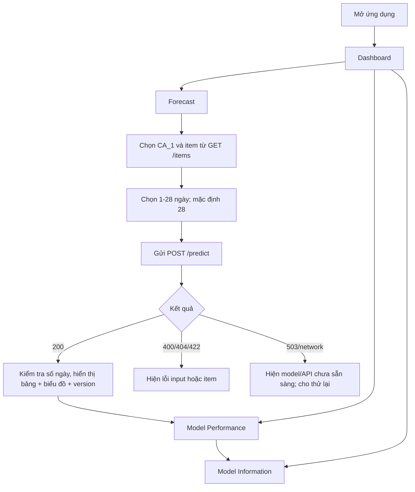

# L01 — Phân tích chức năng ứng dụng M5

**Người thực hiện:** Lâm · **Giai đoạn:** GĐ1 · **Đầu ra:** use case, user flow, wireframe và danh sách trường API.

## Nguồn và phạm vi

Đặc tả này dùng [H01: hồ sơ dữ liệu](../reports/data_profile.md), [danh sách 300 item MVP](../reports/m5_mvp_items.csv), [HI01: bài toán ML](../reports/ml_problem.md) và [OpenAPI contract của Hiếu](api_contract.json). Đây là **tài liệu thiết kế**; các giá trị trong mục `example` của OpenAPI là ví dụ, chưa chứng minh model/API đã chạy hoặc metric đã được đo.

Người dùng là người phân tích hoặc quản lý bán lẻ. Phạm vi MVP đã bàn giao: **1 store `CA_1`, 300 item** (mỗi category FOODS, HOBBIES, HOUSEHOLD có 100 item). Target `sales` là **số đơn vị sản phẩm bán trong một ngày**, không phải doanh thu. Lịch sử hiện có đến **22/05/2016** (`d_1941`); khi dự báo từ lịch sử đầy đủ, ngày đầu tiên là **23/05/2016**. Ngày bắt đầu cần lấy từ response thực tế, không gắn cứng trong UI.

## Chức năng bốn trang

| Trang | Người dùng cần làm gì | Dữ liệu và nguồn | Trạng thái trống/lỗi |
|---|---|---|---|
| **Dashboard** | Xem phạm vi MVP và diễn biến lượng bán. Lọc theo category/item nếu có dữ liệu. | Số store, số item, khoảng ngày, tổng và trung bình **units bán/ngày**, biểu đồ units theo ngày. Nguồn là dữ liệu processed/summary của Hùng, chưa có endpoint Dashboard trong OpenAPI. | Khi chưa có nguồn summary, hiển thị “Chưa có dữ liệu tổng quan”; không dựng KPI hoặc biểu đồ giả. |
| **Forecast** | Chọn store, item, horizon rồi xem dự báo. | Store `CA_1`; item lấy từ `GET /items`; horizon **1–28**, mặc định **28**. `POST /predict` trả bảng/biểu đồ theo ngày, tổng predicted units, model/data version. | Hiển thị loading, input không hợp lệ, item ngoài MVP, model chưa sẵn sàng hoặc lỗi kết nối. Kết quả cũ không được gắn sang lựa chọn mới. |
| **Model Performance** | Xem chất lượng model và so actual với predicted trên validation. | `GET /model-info` cung cấp `validation_subset_rmsse`, `validation_subset_wrmsse`, `validation_mae`, `validation_rmse` và `metric_scope_note`. Dữ liệu actual/predicted từng ngày **chưa có trong OpenAPI**; cần artifact hoặc endpoint riêng sau khi Hiếu bàn giao. | Nếu model trả 503 hoặc chưa có metric thật, hiển thị “Chưa có kết quả đánh giá”; không dùng số ví dụ trong contract. Biểu đồ đối chiếu chờ dữ liệu. |
| **Model Information** | Biết model nào đang phục vụ và phạm vi áp dụng. | `GET /model-info`: name, version, algorithm, training date, data version, status, store scope, item count, horizon, features, temporal split, metric scope. | Nếu 503/training/uninitialized, hiển thị đúng trạng thái; không đoán version hoặc ngày train. |

**Quy tắc số liệu:** Dashboard và biểu đồ dùng đơn vị **units**, không ghi USD. Dự báo có thể là số thập phân (contract mô tả làm tròn hai chữ số); UI không ép về số nguyên. Metric chỉ được gọi là **subset RMSSE/WRMSSE cho CA_1 và 300 item**, không phải điểm toàn bộ M5. Mọi dữ liệu tĩnh dùng khi dựng UI GĐ2 phải gắn nhãn **“Mock/Minh họa”** ngay trên màn hình liên quan.

## Use case và tiêu chí

| Mã | Hành động | Điều kiện và kết quả mong đợi |
|---|---|---|
| UC01 | Mở Dashboard; lọc category/item khi có. | Số liệu và biểu đồ cùng phạm vi, cùng khoảng ngày; thiếu summary thì có empty state. |
| UC02 | Mở Forecast; chọn `CA_1` và item từ danh sách MVP; nhấn Dự báo. | Gửi `store_id`, `item_id`, `horizon` (mặc định 28); khi thành công, bảng và biểu đồ dùng cùng mảng `forecast`, đúng số ngày yêu cầu và hiện model version. |
| UC03 | Đổi item hoặc horizon rồi dự báo lại. | Xóa kết quả cũ trước khi hiển thị kết quả mới; loading rõ; không gửi trùng request. |
| UC04 | Nhập sai horizon hoặc item ngoài MVP. | Báo lỗi 400/404/422 rõ ràng; không hiển thị dự báo giả hoặc dữ liệu cũ như kết quả mới. |
| UC05 | API không kết nối hoặc model chưa load. | Có trạng thái kết nối/503 và nút thử lại; `GET /health` chỉ cho biết dịch vụ API, `model_loaded` cho biết tình trạng model. |
| UC06 | Mở Model Performance và Model Information. | Metric có nhãn phạm vi; metadata đúng response; biểu đồ actual/predicted chỉ xuất hiện khi có dữ liệu validation thật. |

## User flow

[Wireframe bốn trang](wireframes.md) thể hiện bố cục và các trạng thái chính.

## Danh sách trường API bàn giao cho L02/L04

**Nguồn chuẩn:** [`docs/api_contract.json`](api_contract.json), OpenAPI 3.0.3. Bảng sau tóm tắt contract; khi triển khai cần đối chiếu schema gốc.

| API | Trường dùng ở UI | Quy tắc |
|---|---|---|
| `GET /items?category=...` | Response: `store_id`, `total_items`, `categories_breakdown`, `items[]` với `item_id`, `dept_id`, `cat_id`. | Dropdown chỉ nhận item MVP; `category` có thể là FOODS/HOBBIES/HOUSEHOLD. |
| `POST /predict` request | `store_id` bắt buộc (hiện chỉ `CA_1`), `item_id` bắt buộc, `horizon` tùy chọn. | `horizon` nguyên 1–28, mặc định 28. |
| `POST /predict` response | `store_id`, `item_id`, `dept_id`, `cat_id`, `state_id`, `model_version`, `data_version`, `forecast_start_date`, `horizon`, `total_predicted_sales`, `forecast[]`. | Mỗi phần tử `forecast` có `date`, `day_of_week`, `predicted_sales`; số phần tử bằng `horizon`, ngày liên tiếp, dự báo hữu hạn và không âm. |
| `GET /model-info` | `model_name`, `model_version`, `algorithm`, `status`, `training_date`, `data_version`, `store_scope`, `item_count`, `forecast_horizon`, `features_used`, `temporal_split`, `metrics`. | `status`: ready/training/uninitialized; `metrics` gồm subset RMSSE, subset WRMSSE, MAE, RMSE, scope note. 503 khi model chưa có. |
| `GET /health` | `status`, `service`, `version`, `model_loaded`, `timestamp`. | Health của API không thay thế kiểm tra model và dự báo. |
| Lỗi `/predict` | 400, 404, 422, 503; `ErrorResponse` có `error_code`, `detail`, `timestamp`; validation 422 có `detail[]`. | UI hiển thị thông điệp phù hợp, không coi mọi lỗi là một trường hợp. |

## Điểm cần bàn giao tiếp ở giai đoạn sau

- **Hùng → Lâm/L02/L04:** cách cấp dữ liệu tổng quan Dashboard và metadata item; OpenAPI hiện có `/items` nhưng chưa có endpoint Dashboard.
- **Hiếu → Lâm/L04:** kết quả actual/predicted theo ngày trên validation để vẽ Model Performance; `/model-info` chỉ có metric tổng hợp.
- **Hiếu → Lâm/L03:** model artifact, inference function, feature order và quy tắc nhiều bước khi chuyển sang API dự báo thật.
- **Quân:** hạ tầng Azure không phải đầu vào bắt buộc của L01; URL ACI trong OpenAPI là **ví dụ cấu hình**, chưa phải bằng chứng endpoint đang hoạt động.

**Kiểm tra L01:** Đã có mục đích/dữ liệu/trạng thái cho cả bốn trang, use case, user flow, wireframe và field list khớp contract. Phần triển khai API/UI và số liệu model thực thuộc GĐ2–GĐ3.
