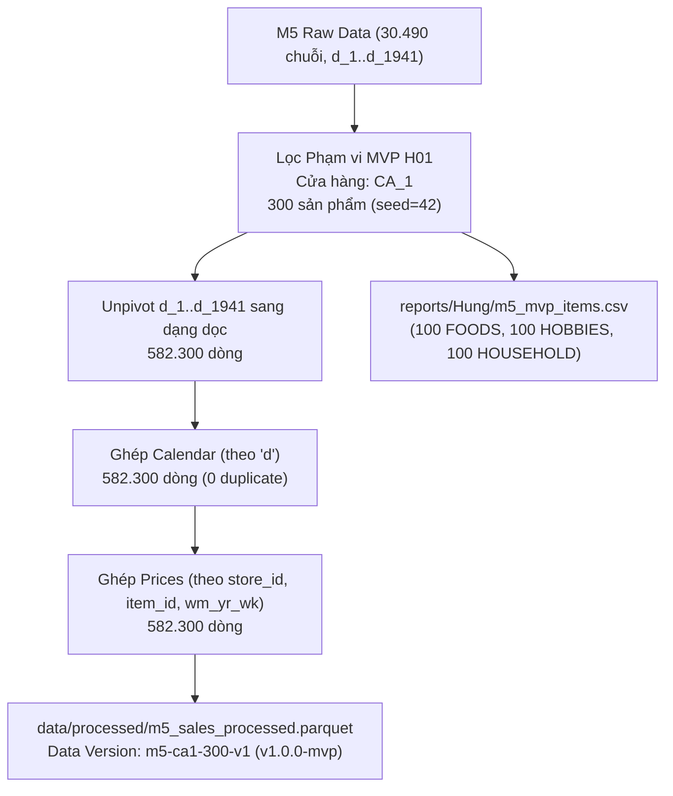
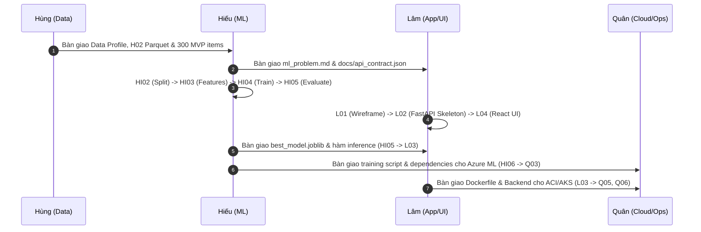

# Báo cáo Xác định Bài toán Machine Learning — HI01 (Hiếu)

**Dự án:** IS402.R11-BT2 — Azure Retail Demand Forecasting MLOps  
**Giai đoạn:** GĐ1 — Khởi tạo dự án & Xác định bài toán  
**Tác giả:** Nguyễn Trung Hiếu (Machine Learning Engineer)  
**Phối hợp & Tiếp nhận:** Lê Hoàng Hùng (Data Engineer — H01, H02), Đoàn Văn Lâm (Application Engineer — L01, L02, L03), Lê Hồng Quân (Cloud/DevOps Engineer — Q01, Q02, Q03)  
**Tài liệu tham chiếu:** `reports/Hung/data_profile.md`, `reports/Hung/h02_processing.md`, `reports/Hung/h02_processing_log.json`, `reports/Hung/m5_mvp_items.csv`

---

## 1. Bối cảnh và Mục tiêu Bài toán

Dự án hướng đến việc xây dựng một hệ thống MLOps hoàn chỉnh trên Microsoft Azure nhằm tự động hóa quy trình dự báo nhu cầu bán lẻ (Retail Demand Forecasting) dựa trên chuỗi thời gian thực tế từ cuộc thi quốc tế [M5 Forecasting – Accuracy (Kaggle / Walmart)](https://www.kaggle.com/competitions/m5-forecasting-accuracy/data).

Nhiệm vụ **HI01** có mục đích:
1. Thống nhất mô hình bài toán dự báo nhu cầu bán lẻ cho từng mặt hàng tại cửa hàng.
2. Đồng bộ hóa 100% phạm vi dữ liệu MVP do kỹ sư dữ liệu Lê Hoàng Hùng (H01/H02) đã hoàn thiện và làm sạch.
3. Chuẩn hóa định nghĩa biến mục tiêu (target), không gian đặc trưng (feature store), nguyên tắc chống rò rỉ dữ liệu (anti-leakage), chiến lược phân chia tập dữ liệu theo chuỗi thời gian (temporal split) chuẩn bị cho nhiệm vụ **HI02**.
4. Thiết lập hệ thống chỉ số đo lường đánh giá mô hình (metrics) phù hợp với bản chất dữ liệu bán lẻ có tần suất bán gián đoạn (intermittent demand).
5. Bàn giao giao ước dữ liệu API (`docs/api_contract.json`) cho kỹ sư ứng dụng Đoàn Văn Lâm (L01..L03) để xây dựng Backend FastAPI và Frontend React.

---

## 2. Tổng quan Bộ dữ liệu M5 & Vai trò Từng Nguồn Dữ liệu

Dữ liệu thô M5 gồm 5 file CSV đặt trong `data/raw/` (được loại trừ khỏi Git để bảo đảm dung lượng repo). Vai trò và nguyên tắc khai thác từng file như sau:

| Tên File | Số Dòng | Số Cột | Dung lượng (MiB) | Vai trò & Quy tắc Sử dụng trong Dự án |
| :--- | :---: | :---: | :---: | :--- |
| `sales_train_evaluation.csv` | 30.490 | 1.947 | 116,10 | **Nguồn dữ liệu nhãn bán hàng (Ground Truth) chính của dự án.** Chứa toàn bộ 30.490 chuỗi bán lẻ từ ngày `d_1` đến `d_1941`. Dùng cho cả quá trình huấn luyện (Train), kiểm định (Validation), và kiểm thử độc lập (Holdout Test). |
| `sales_train_validation.csv` | 30.490 | 1.919 | 114,45 | Chứa lịch sử bán hàng từ `d_1` đến `d_1913`. **QUY TẮC BẮT BUỘC:** Lịch sử từ `d_1` đến `d_1913` trùng lặp 100% với `sales_train_evaluation.csv`. **Tuyệt đối KHÔNG nối (concatenate / append) hai file này với nhau** để tránh nhân đôi quan sát, làm sai lệch phân phối và rò rỉ dữ liệu. File này chỉ mang tính lịch sử của vòng thi validation trên Kaggle. |
| `calendar.csv` | 1.969 | 14 | 0,10 | Bảng ánh xạ mã ngày tương đối `d` (`d_1` đến `d_1969`) sang ngày thực tế `date` (29/01/2011 đến 19/06/2016), mã tuần bán lẻ Walmart `wm_yr_wk`, thứ trong tuần (`weekday`, `wday`), tháng, năm, các sự kiện lễ hội (`event_name_1/2`, `event_type_1/2`) và cờ trợ cấp dinh dưỡng SNAP theo bang (`snap_CA`, `snap_TX`, `snap_WI`). |
| `sell_prices.csv` | 6.841.121 | 4 | 193,97 | Bảng giá bán hàng tuần theo bộ khóa (`store_id`, `item_id`, `wm_yr_wk`). Giá quan sát từ \$0,01 đến \$107,32. Cung cấp thông tin giá bán và biến động chính sách giá. |
| `sample_submission.csv` | 60.980 | 29 | 4,99 | **Chỉ là file template mẫu định dạng kết quả nộp bài** (gồm 60.980 dòng với 2 khối 30.490 chuỗi cho validation và evaluation, chứa các cột `id`, `F1` đến `F28`). **Tuyệt đối không chứa nhãn thực tế và không được dùng làm dữ liệu huấn luyện.** |

---

## 3. Phạm vi Dữ liệu MVP Thực tế (Bàn giao từ Hùng — H01/H02)

Để tối ưu hóa chi phí điện toán đám mây Azure (theo hạn mức subscription sinh viên) và đảm bảo tính khả thi trong việc huấn luyện mô hình, nhóm đã thống nhất và chốt phạm vi dữ liệu Minimum Viable Product (MVP) do Hùng bàn giao tại `reports/Hung/data_profile.md` và `reports/Hung/h02_processing.md`:



### 3.1. Các thông số định lượng của tập dữ liệu MVP
- **Cửa hàng lựa chọn (`store_id`):** `CA_1` (Store số 1 tại bang California, thuộc hệ thống Walmart).
- **Bang (`state_id`):** `CA` (Toàn bộ chuỗi thuộc bang California $\rightarrow$ chính sách SNAP tương ứng trực tiếp là `snap_CA`).
- **Số lượng sản phẩm đại diện (`item_id`):** **300 sản phẩm** lấy mẫu ngẫu nhiên có kiểm soát (`random_state=42`) phân bổ đều trên 3 nhóm hàng:
  - **FOODS:** 100 sản phẩm (thuộc các phân ngành `FOODS_1`, `FOODS_2`, `FOODS_3`).
  - **HOBBIES:** 100 sản phẩm (thuộc các phân ngành `HOBBIES_1`, `HOBBIES_2`).
  - **HOUSEHOLD:** 100 sản phẩm (thuộc các phân ngành `HOUSEHOLD_1`, `HOUSEHOLD_2`).
- **Tổng số chuỗi thời gian đơn lẻ:** 300 chuỗi (`store_id` $\times$ `item_id`).
- **Độ dài lịch sử quan sát:** **1.941 ngày** (từ `d_1` tương ứng 29/01/2011 đến `d_1941` tương ứng 22/05/2016).
- **Tổng số dòng sau khi unpivot (melt) và liên kết bảng:** **582.300 bản ghi** ($300 \text{ chuỗi} \times 1.941 \text{ ngày}$).
- **Trùng lặp khóa định danh (`item_id`, `store_id`, `d`):** **0** (không có bản ghi trùng lặp).
- **Tập tin lưu trữ dữ liệu sạch:** `data/processed/m5_sales_processed.parquet` (kích thước nén ~620,52 KiB, 22 cột dữ liệu, kiểu nén PyArrow tối ưu bộ nhớ).
- **Mã phiên bản dữ liệu (Data Version):** `m5-ca1-300-v1` (phiên bản ngữ nghĩa `v1.0.0-mvp`).
- **Nhật ký xử lý (Audit Log):** `reports/Hung/h02_processing_log.json`.

### 3.2. Đặc điểm thống kê quan trọng của mẫu MVP
1. **Hiện tượng Nhu cầu Gián đoạn (Intermittent / Zero-Inflated Sales):**
   - Trong 582.300 quan sát doanh số, có tới **378.662 dòng (65,03%) mang giá trị `sales = 0`**.
   - Tổng lượng bán tích lũy trong toàn bộ lịch sử 1.941 ngày là **748.327 đơn vị sản phẩm**.
   - Phân phối doanh số bị lệch phải mạnh (positive skew), nhiều ngày không có giao dịch bán phát sinh.
2. **Xử lý giá bán khuyết (`missing sell_price`):**
   - Có **104.538 dòng (17,95%)** bị khuyết giá bán trong bảng sau khi ghép.
   - **Bản chất nghiệp vụ:** Toàn bộ 104.538 dòng này nằm ở giai đoạn đầu của chuỗi thời gian, tức là *trước thời điểm sản phẩm đó bắt đầu được nhập và mở bán chính thức tại siêu thị CA_1*. Kể từ tuần đầu tiên xuất hiện giá trở đi, không có bất kỳ dòng nào bị thiếu giá.
   - **Quy tắc cho ML:** Giữ nguyên trạng thái tự nhiên trong pipeline H02. Khi đưa vào mô hình hóa (HI03), ta sẽ gắn cờ `is_active = 0` cho giai đoạn trước mở bán hoặc gán giá trị mặc định để tránh thiên lệch học tập (lookahead bias).

---

## 4. Định nghĩa Bài toán Machine Learning & Target

### 4.1. Bản chất Bài toán
- **Tên bài toán:** Multi-Step Multi-Series Retail Demand Forecasting (Dự báo nhu cầu bán lẻ đa chuỗi, đa bước thời gian).
- **Mô hình học máy:** Học có giám sát trên dữ liệu dạng bảng hồi quy (Supervised Tabular Regression) kết hợp xử lý chuỗi thời gian (Time-series Feature Engineering). Các thuật toán mục tiêu gồm: LightGBM, XGBoost, Random Forest Regressor.

### 4.2. Định nghĩa Biến Mục Tiêu (Target Variable)
- **Tên biến:** `sales`
- **Ý nghĩa:** Số lượng đơn vị sản phẩm được bán ra trong một ngày cụ thể tại một cửa hàng cụ thể (Daily Unit Sales).
- **Miền giá trị:** Số nguyên không âm, $y_{i,t} \in \mathbb{Z}_{\ge 0}$ ($sales \ge 0$).
- **Nguyên tắc cốt lõi về xử lý Ngày Doanh Số Bằng 0 (`sales = 0`):**
  > [!IMPORTANT]
  > **BẮT BUỘC GIỮ NGUYÊN TOÀN BỘ CÁC NGÀY `sales = 0`**.  
  > Trong bán lẻ, ngày có doanh số bằng 0 là một quan sát thực tế hoàn toàn hợp lệ (phản ánh hiện tượng nhu cầu tự nhiên bằng 0 hoặc hết hàng tạm thời), không phải là dữ liệu thiếu (missing data) và không được phép drop hoặc coi là outlier. Việc giữ nguyên zero-sales là điều kiện tiên quyết để mô hình nắm bắt được xác suất phát sinh nhu cầu (intermittent demand frequency).

### 4.3. Cặp Khóa và Metadata Phân Cấp (Hierarchical Metadata)
Mỗi chuỗi thời gian được định danh duy nhất bởi cặp khóa (`item_id`, `store_id`), gắn liền với cây phân cấp sản phẩm và địa lý:
- `store_id`: `CA_1`
- `state_id`: `CA`
- `cat_id`: Nhóm ngành hàng lớn (`FOODS`, `HOBBIES`, `HOUSEHOLD`).
- `dept_id`: Phân ngành chi tiết (`FOODS_1`, `FOODS_2`, `FOODS_3`, `HOBBIES_1`, `HOBBIES_2`, `HOUSEHOLD_1`, `HOUSEHOLD_2`).
- `item_id`: Mã sản phẩm cụ thể (ví dụ: `FOODS_1_017`, `HOBBIES_1_003`, `HOUSEHOLD_1_011`).

---

## 5. Không gian Đặc trưng (Feature Engineering Framework — Chuẩn bị cho HI03)

Để huấn luyện các mô hình cây quyết định (LightGBM / XGBoost / Random Forest), dữ liệu chuỗi thời gian sẽ được làm giàu qua 4 nhóm đặc trưng:

```text
               +-------------------------------------------------------------+
               |                    FEATURE STORE FRAMEWORK                  |
               +-------------------------------------------------------------+
                                              |
        +-------------------+-----------------+-------------------+-------------------+
        |                   |                                     |                   |
        v                   v                                     v                   v
+---------------+   +----------------+                    +---------------+   +---------------+
| Sales History |   | Calendar/Time  |                    | Pricing Info  |   | Metadata/IDs  |
+---------------+   +----------------+                    +---------------+   +---------------+
| lag_1, 7, ... |   | wday, weekday  |                    | sell_price    |   | item_id       |
| rolling_mean  |   | month, year    |                    | price_change  |   | dept_id       |
| (Shift 1 safe)|   | events, snap_CA|                    | is_active     |   | cat_id        |
+---------------+   +----------------+                    +---------------+   +---------------+
```

### 5.1. Nhóm 1: Lịch sử Bán hàng (Lag & Rolling Features) — Cơ chế Chống Rò Rỉ Dữ Liệu
Các đặc trưng quá khứ giúp mô hình học tính quán tính và chu kỳ tuần hoàn ngắn hạn:
- **Đặc trưng độ trễ (Lags):** `lag_1`, `lag_7`, `lag_14`, `lag_28`
  - `lag_1`: Doanh số ngày hôm trước.
  - `lag_7`: Doanh số cùng thứ này tuần trước.
  - `lag_14`: Doanh số cùng thứ này 2 tuần trước.
  - `lag_28`: Doanh số đúng 4 tuần (1 chu kỳ horizon) trước đó.
- **Đặc trưng trượt (Rolling Statistics):** `rolling_mean_7`, `rolling_mean_28` (trung bình trượt 7 ngày và 28 ngày), có thể bổ sung `rolling_std_7`.
- **Nguyên tắc chống rò rỉ dữ liệu (Anti-Data Leakage):**
  > [!CAUTION]
  > Toàn bộ các biến trượt (rolling) và lag phải được tính toán dựa trên `sales.shift(1)` trở về trước theo từng chuỗi `(store_id, item_id)`.  
  > Tuyệt đối không bao gồm giá trị `sales` của chính ngày hiện tại $t$ khi tính toán rolling window, nhằm loại bỏ 100% rủi ro Lookahead Bias:
  > $$\text{rolling\_mean\_7}(t) = \frac{1}{7}\sum_{k=1}^{7} \text{sales}(t - k)$$

### 5.2. Nhóm 2: Lịch & Biến động Thời gian (Calendar & Events)
- **Chu kỳ tuần và tháng:** `wday` (1 đến 7, trong đó 1 là Thứ Bảy theo quy ước Walmart), `weekday`, `month` (1 đến 12), `year` (xu hướng dài hạn).
- **Sự kiện văn hóa / lễ hội:** `event_name_1`, `event_type_1`, `event_name_2`, `event_type_2` (mã hóa các ngày lễ như SuperBowl, Valentine's Day, Thanksgiving, Christmas; gán nhãn `'None'` cho các ngày không có sự kiện).
- **Chính sách trợ cấp dinh dưỡng SNAP:** 
  - Khai thác cột `snap_CA` đại diện cho việc chính phủ Mỹ chi trả trợ cấp lương thực tại bang California vào các ngày đầu tháng.
  - Hai cột `snap_TX` và `snap_WI` không áp dụng cho cửa hàng `CA_1` nên được lược bỏ để tránh nhiễu mô hình.

### 5.3. Nhóm 3: Giá bán & Biến động Khuyến mãi (Pricing Dynamics)
- **Khóa ghép bảng:** Ghép trực tiếp từ `sell_prices.csv` theo bộ 3 khóa `(store_id, item_id, wm_yr_wk)`.
- **Đặc trưng phái sinh từ giá:**
  - `sell_price`: Giá bán hiện tại.
  - `price_change_weekly`: Tỷ lệ thay đổi giá so với tuần trước ($\frac{P_t - P_{t-1}}{P_{t-1}}$).
  - `price_discount_ratio`: Tỷ lệ chiết khấu so với mức giá lịch sử cao nhất ($\frac{P_{\max} - P_t}{P_{\max}}$).
  - `is_active`: Cờ nhị phân (1: sản phẩm đã được mở bán, 0: sản phẩm chưa xuất hiện trên kệ hàng, tương ứng với 104.538 dòng khuyết giá ban đầu).

### 5.4. Nhóm 4: Phân loại & Thứ bậc (Categorical Embeddings / Encodings)
- Các biến phân loại gồm: `item_id`, `dept_id`, `cat_id`.
- Sẽ được mã hóa dạng Label Encoding hoặc Categorical Dtype trong LightGBM/XGBoost để mô hình học sự khác biệt giữa các nhóm ngành hàng (ví dụ đồ ăn nhanh có tốc độ xoay vòng cao hơn đồ gia dụng).

---

## 6. Horizon & Chiến lược Chia Tập Dữ liệu (Chuẩn bị cho HI02)

### 6.1. Chiều dài Dự báo (Forecast Horizon)
- **Độ dài Horizon:** **$h = 28$ ngày** (tương đương chu kỳ 4 tuần bán lẻ chuẩn của Walmart và quy chuẩn bài toán M5 Forecasting).
- **Điểm bắt đầu dự báo ($T+1$):** Ngày liền sau ngày cuối cùng của chuỗi lịch sử quan sát được cung cấp.

### 6.2. Thiết kế Backtest theo Thứ tự Thời gian (Temporal Split)
Để mô phỏng chính xác môi trường triển khai thực tế của hệ sinh thái MLOps, dữ liệu 1.941 ngày sẽ được phân chia cố định theo trục thời gian, tuyệt đối không dùng phương pháp chia ngẫu nhiên (Random K-Fold) vì sẽ làm đứt gãy cấu trúc chuỗi thời gian và gây rò rỉ thông tin tương lai:

| Phân Tập | Khoảng Mã Ngày | Khoảng Ngày Lịch Thực Tế | Số Ngày | Số Bản Ghi (300 chuỗi) | Mục Đích Sử Dụng |
| :--- | :---: | :---: | :---: | :---: | :--- |
| **Train Set** | `d_1` đến `d_1885` | 29/01/2011 — 27/03/2016 | 1.885 | 565.500 | Huấn luyện mô hình (học trọng số, đặc trưng lag, rolling, calendar, price). |
| **Validation Set** | `d_1886` đến `d_1913` | 28/03/2016 — 24/04/2016 | 28 | 8.400 | Tinh chỉnh siêu tham số (Hyperparameter tuning), chọn mô hình tốt nhất (Best Model Selection). |
| **Holdout (Test) Set** | `d_1914` đến `d_1941` | 25/04/2016 — 22/05/2016 | 28 | 8.400 | Đánh giá độc lập lần cuối trước khi đăng ký Model Registry và triển khai. Tương ứng chính xác tập Evaluation của M5. |
| **Inference Production** | `d_1942` đến `d_1969` | 23/05/2016 — 19/06/2016 | 28 | 8.400 | Cửa sổ dự báo tương lai thực tế phục vụ người dùng qua Web UI / REST API. |

```text
Trục Thời Gian (Timeline):
|----------------------------- TRAIN -----------------------------|--- VALIDATION ---|----- HOLDOUT -----|-> INFERENCE (API)
d_1                                                            d_1885 d_1886      d_1913 d_1914      d_1941  d_1942         d_1969
(29/01/2011)                                              (27/03/2016) (28/03/16) (24/04/16) (25/04/16) (22/05/16) (23/05/16)   (19/06/16)
```

### 6.3. Chiến lược Suy luận Dự báo 28 Ngày (Inference Strategy)
Khi dự báo 28 bước về tương lai ($t+1 \dots t+28$), các biến `lag_1` đến `lag_27` của những ngày trong tương lai chưa có giá trị thực tế. Nhóm thống nhất lựa chọn một trong 2 giải pháp kỹ thuật cho HI03/HI04:
1. **Phương pháp Đệ quy (Recursive / Autoregressive Forecasting):** Dự báo từng ngày một; giá trị dự báo $\hat{y}_{t+1}$ được nạp ngược lại làm lag giả định để dự báo tiếp $t+2$ cho đến $t+28$.
2. **Phương pháp Độ trễ An toàn (Horizon-Aligned Direct Lag):** Chỉ sử dụng các biến lag từ `lag_28` trở lên (`lag_28`, `lag_35`, `lag_42`) và rolling features tính trước mốc $T-28$. Phương pháp này cho phép dự báo đồng thời 28 ngày chỉ với một lượt suy luận duy nhất (Single-pass inference), rất nhanh và ổn định khi triển khai API thực tế.

---

## 7. Hệ thống Metrics Đánh giá Mô hình (Model Evaluation Metrics)

### 7.1. Metric Cốt lõi: RMSSE (Root Mean Squared Scaled Error)
Đối với chuỗi thời gian bán lẻ $i$ trên cửa sổ dự báo độ dài $h = 28$, công thức tính $RMSSE_i$ là:

$$RMSSE_i = \sqrt{\frac{\frac{1}{h}\sum_{t=n+1}^{n+h}\left(y_{i,t} - \hat{y}_{i,t}\right)^2}{\frac{1}{n-1}\sum_{t=2}^{n}\left(y_{i,t} - y_{i,t-1}\right)^2}}$$

*Trong đó:*
- $n$: Độ dài lịch sử huấn luyện của chuỗi (ví dụ: 1.885 ngày).
- $h$: Độ dài khoảng dự báo ($h = 28$).
- $y_{i,t}$: Doanh số thực tế của sản phẩm $i$ tại ngày $t$.
- $\hat{y}_{i,t}$: Doanh số dự báo của sản phẩm $i$ tại ngày $t$.
- **Mẫu số:** Là sai số bình phương trung bình của mô hình ngây thơ (Naive 1-step forecast: dự báo ngày mai bằng chính doanh số ngày hôm nay) trên tập huấn luyện.

**Lý do chọn RMSSE:**
- **Không bao giờ bị lỗi chia cho 0:** Mẫu số tính trên độ biến thiên sai phân lịch sử của tập train, luôn dương (miễn là sản phẩm có phát sinh bán hàng). Do đó, ngay cả khi $y_{i,t} = 0$ trong cửa sổ dự báo, phép tính vẫn hoàn toàn ổn định.
- **Scale-free (Không phụ thuộc đơn vị quy mô):** Cho phép so sánh công bằng giữa các mặt hàng bán chạy hàng nghìn cái/ngày với các mặt hàng chậm (slow-moving) chỉ bán vài cái mỗi tuần.

### 7.2. Metric Phân cấp: WRMSSE (Weighted RMSSE)
$$WRMSSE = \sum_{i=1}^{M} w_i \times RMSSE_i$$

Trong đó $w_i$ là trọng số doanh thu (dựa trên tỷ trọng doanh số đơn vị nhân với giá bán trong 28 ngày cuối của tập train).

> [!WARNING]
> **QUY ĐỊNH BẮT BUỘC VỀ DANH XƯNG METRIC:**  
> Trong dự án này, do mô hình được huấn luyện và đánh giá trên tập đại diện MVP gồm 300 sản phẩm tại cửa hàng `CA_1` (thay vì toàn bộ 30.490 chuỗi trên 10 cửa hàng và 12 cấp phân cấp toàn nước Mỹ), nên mọi kết quả đo lường phải được báo cáo chính xác là **"Subset RMSSE"** hoặc **"Subset WRMSSE"**. Tuyệt đối **không được gọi là điểm WRMSSE toàn cuộc thi** để đảm bảo tính chuẩn xác và liêm chính học thuật.

### 7.3. Metrics Bổ trợ Nghiệp vụ: MAE và RMSE
- **MAE (Mean Absolute Error):**
  $$MAE = \frac{1}{M \cdot h}\sum_{i=1}^{M}\sum_{t=n+1}^{n+h} |y_{i,t} - \hat{y}_{i,t}|$$
  Trực quan, dễ giải thích cho nhà quản lý siêu thị: sai số lệch trung bình bao nhiêu sản phẩm mỗi ngày.
- **RMSE (Root Mean Squared Error):**
  $$RMSE = \sqrt{\frac{1}{M \cdot h}\sum_{i=1}^{M}\sum_{t=n+1}^{n+h} (y_{i,t} - \hat{y}_{i,t})^2}$$
  Phạt nặng các sai số đột biến lớn (như dự báo thiếu hàng nghiêm trọng trong các ngày nhu cầu tăng đột biến).

### 7.4. Phân tích Lý do KHÔNG Dùng sMAPE làm Metric Chính
Chỉ số $sMAPE$ (Symmetric Mean Absolute Percentage Error) có công thức:
$$sMAPE = \frac{100\%}{h} \sum_{t=1}^{h} \frac{2 |y_t - \hat{y}_t|}{|y_t| + |\hat{y}_t|}$$

**Hạn chế chí mạng trên dữ liệu M5:**
1. Trong tập MVP, có tới **65,03% số ngày có `sales = 0`**. Khi thực tế $y_t = 0$ và dự báo $\hat{y}_t = 0$, công thức rơi vào dạng vô định $0/0$.
2. Khi thực tế $y_t = 0$ nhưng mô hình dự báo ra một lượng rất nhỏ $\hat{y}_t = 0,1$ hoặc $1$ sản phẩm, công thức luôn trả về mức sai số cực đại là $\frac{2|\hat{y}_t|}{|\hat{y}_t|} = 2$ (**200%**). Điều này dẫn đến việc mô hình bị phạt kịch khung bất kể độ lệch lớn hay nhỏ, làm méo mó thước đo và vô hiệu hóa quá trình tối ưu hóa hàm mất mát (loss function).
3. Do đó, $sMAPE$ chỉ được tính như một chỉ số tham khảo thêm, tuyệt đối không dùng làm metric chính để chọn mô hình tốt nhất.

---

## 8. Đặc tả Giao ước API (API Contract Bàn giao cho Lâm — L01..L03)

Để phục vụ phát triển độc lập và song song giữa Backend/Frontend (Lâm) và Modeling (Hiếu), giao ước API đã được chuẩn hóa chi tiết dưới định dạng OpenAPI 3.0.3 tại tập tin `docs/api_contract.json`.

### 8.1. Danh mục Endpoints Cốt lõi

| Phương Thức | Đường Dẫn Endpoint | Chức Năng | Trạng Thái Phản Hồi |
| :---: | :--- | :--- | :---: |
| `POST` | `/predict` | Dự báo số lượng bán trong 28 ngày cho một cặp (`store_id`, `item_id`). | `200`, `400`, `404`, `422`, `503` |
| `GET` | `/model-info` | Lấy siêu dữ liệu mô hình hiện hành, phiên bản, thuật toán và metrics đánh giá. | `200`, `503` |
| `GET` | `/health` | Kiểm tra tính khả dụng và tình trạng hoạt động của dịch vụ dự báo. | `200` |
| `GET` | `/items` | Danh sách 300 sản phẩm MVP tại `CA_1` để nạp dữ liệu cho dropdown trên Web UI. | `200` |

### 8.2. Cấu trúc Endpoint Dự báo `POST /predict`
- **Request Body mẫu:**
  ```json
  {
    "store_id": "CA_1",
    "item_id": "FOODS_1_017",
    "horizon": 28
  }
  ```
- **Response Body mẫu (`200 OK`):**
  ```json
  {
    "store_id": "CA_1",
    "item_id": "FOODS_1_017",
    "dept_id": "FOODS_1",
    "cat_id": "FOODS",
    "state_id": "CA",
    "model_version": "xgb-regressor-v1.0.0",
    "data_version": "m5-ca1-300-v1",
    "forecast_start_date": "2016-05-23",
    "horizon": 28,
    "forecast": [
      {
        "date": "2016-05-23",
        "predicted_sales": 1.42,
        "day_of_week": "Monday"
      },
      {
        "date": "2016-05-24",
        "predicted_sales": 0.85,
        "day_of_week": "Tuesday"
      }
    ]
  }
  ```
  *(Lưu ý: Mảng `forecast` trả về đúng 28 phần tử liên tiếp, `predicted_sales` luôn $\ge 0$).*

### 8.3. Bảng Quy chuẩn Mã Lỗi HTTP
- `400 Bad Request`: Horizon không hợp lệ (ví dụ: $horizon \le 0$ hoặc $horizon > 28$).
- `404 Not Found`: Không tìm thấy cửa hàng hoặc sản phẩm trong danh sách MVP 300 items (ví dụ: `item_id: "FOODS_9_999"`).
- `422 Unprocessable Entity`: Sai kiểu dữ liệu truyền vào theo chuẩn schema Pydantic.
- `503 Service Unavailable`: Mô hình chưa được nạp vào bộ nhớ hoặc đang trong quá trình khởi tạo (Cold Start / Model Loading).

---

## 9. Ma trận Phân công và Bàn giao Giữa các Thành viên



1. **Hùng (Data Engineer):** Đã hoàn tất H01 và H02; dữ liệu sạch `m5_sales_processed.parquet` và danh sách 300 sản phẩm tại `reports/Hung/m5_mvp_items.csv` sẵn sàng. Tiếp tục thực hiện H03 (đẩy dữ liệu lên Azure Blob Storage sau khi Quân cấp quyền).
2. **Hiếu (ML Engineer):** Hoàn thành tài liệu xác định bài toán `reports/Hieu/ml_problem.md` và `docs/api_contract.json` (HI01). Tiếp tục triển khai tạo script chia dữ liệu `src/models/split_data.py` (HI02) và tạo đặc trưng `src/features/feature_engineering.py` (HI03).
3. **Lâm (Application Engineer):** Nhận đặc tả API tại `docs/api_contract.json` để tiến hành tạo khung FastAPI (`backend/app/main.py`) và dựng các màn hình React (Dashboard, Forecast, Model Performance, Model Info) theo các schema đã thỏa thuận.
4. **Quân (Cloud/DevOps Engineer):** Tiếp tục cấu hình hạ tầng Azure (Resource Group, Azure Blob Storage, Azure ML Workspace) để phục vụ lưu trữ Parquet (H03) và chạy Azure ML Job (HI06).

---

## 10. Kết luận Nghiệm thu Giai đoạn 1 (HI01)

Nhiệm vụ HI01 đã hoàn thành toàn diện:
- Xác định rõ mô hình bài toán hồi quy dự báo chuỗi thời gian bán lẻ đa bước.
- Đồng bộ tuyệt đối với phạm vi MVP của Hùng (300 items tại `CA_1`, 1.941 ngày, 582.300 bản ghi, giữ nguyên zero-sales 65,03%).
- Định nghĩa rõ ràng chiến lược chia tập Train/Validation/Holdout theo thời gian để chống Lookahead Bias.
- Đóng đinh các tiêu chí đánh giá chuẩn khoa học: `Subset RMSSE`, `Subset WRMSSE`, `MAE`, `RMSE` (loại trừ `sMAPE`).
- Xuất bản giao ước API chuẩn xác tại `docs/api_contract.json`.
